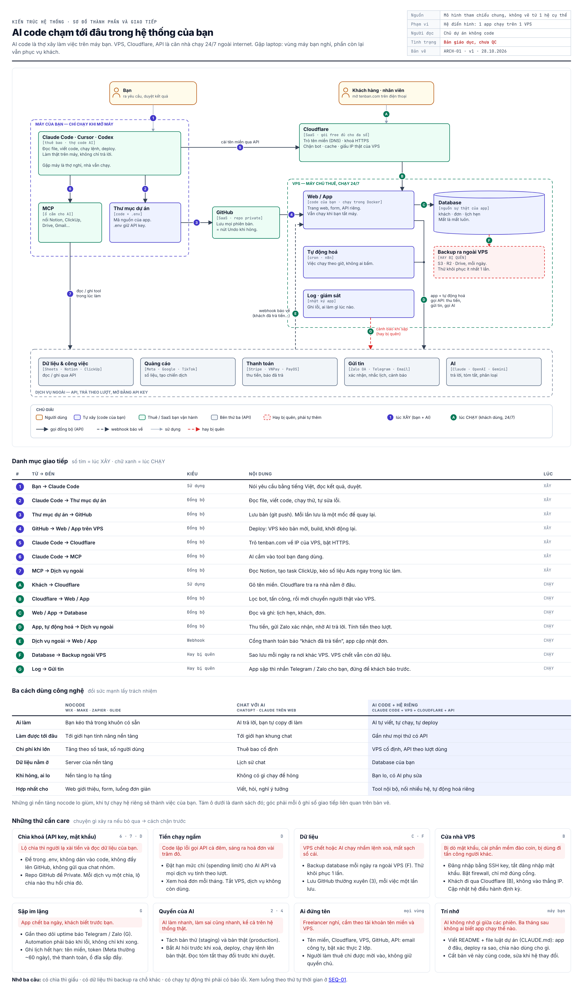

# tool-diagram — skill vẽ sơ đồ kiến trúc hệ thống cho Claude Code

Skill cho [Claude Code](https://claude.com/claude-code) dựng **bộ bản vẽ kiến trúc hệ thống** bằng SVG từ script Python (diagrams as code): có thành phần, ranh giới, mũi tên đánh số, bảng danh mục giao tiếp và khung tên bản vẽ. Ra file HTML + PNG để đưa cho dev, tech lead, client hoặc người không code đọc.



## Có gì

| Bản vẽ | Trả lời câu hỏi | Chuẩn tham chiếu |
|---|---|---|
| `ARCH` | Hệ gồm những gì, ai giữ dữ liệu gì, cái nào gọi cái nào | Container diagram kiểu C4 + interface catalog |
| `SEQ` | Một việc chạy qua những bước nào, ai gọi ai | UML sequence diagram |
| `DATA` | Dữ liệu từ đâu vào, nằm đâu, ra báo cáo gì | Data architecture / DFD mức hệ thống |

Ký pháp cố định: **màu ô = ai sở hữu** (tự xây / thuê SaaS / bên thứ ba), kiểu mũi tên = kiểu giao tiếp (đồng bộ / webhook / thủ công), **ô đỏ nét đứt = chỗ tài liệu nguồn chưa đặc tả**. Skill bắt Claude đọc tài liệu hoặc code thật trước khi vẽ, không bịa kiến trúc.

## Cài đặt

Cần Python 3 (không cần thư viện ngoài) và Google Chrome (để chụp PNG).

```bash
git clone https://github.com/dangpm/tool-diagram ~/.claude/skills/tool-diagram
```

Mở Claude Code rồi gõ `/tool-diagram <tài liệu hoặc repo cần vẽ>`, hoặc nói tự nhiên: "vẽ sơ đồ kiến trúc hệ thống này", "làm sequence diagram cho luồng đặt hàng".

## Dùng tay, không qua Claude

```bash
mkdir my-diagram && cd my-diagram
cp ~/.claude/skills/tool-diagram/lib/*.py ~/.claude/skills/tool-diagram/templates/build_views.py .
python3 build_views.py                                # ra arch-01.html, seq-01.html, data-01.html
python3 render_png.py arch-01.html arch-01.png 1340   # chụp PNG
```

Sửa `build_views.py` (toạ độ đặt tay) rồi build lại. API và luật bố cục ở [reference/notation.md](reference/notation.md).

## Ví dụ: bản đồ AI code cho người không code

[examples/ai-code-system-map/](examples/ai-code-system-map/) giải thích cho người không code: Claude Code trên máy bạn nối với GitHub, VPS, Cloudflare và các API bên ngoài thế nào, lúc XÂY khác lúc CHẠY ra sao, khác nocode ở đâu, và 8 chỗ cần care (API key, chi phí, backup, bảo mật VPS, sập im lặng, quyền của AI, ai đứng tên tài khoản, tài liệu).

```bash
cd examples/ai-code-system-map
python3 build_views.py
```

Mở `arch-01.html` và `seq-01.html` trong trình duyệt.

## Cấu trúc

```
SKILL.md              hướng dẫn cho Claude: workflow, nguyên tắc, ký pháp
lib/archkit.py        bộ vẽ SVG: box, person, cyl, boundary, arrow, badge, legend, seq(), catalog(), page()
lib/render_png.py     chụp toàn trang bằng Chrome headless (macOS / Windows / Linux)
templates/            khuôn khởi đầu (ARCH + SEQ + DATA), bản infographic nhanh --quick
reference/            API, luật bố cục, lỗi render hay gặp
examples/             ví dụ đầy đủ
```

---

### English

A Claude Code skill that draws proper system architecture views (C4-style container diagram with numbered interfaces and an interface catalog, UML sequence diagram, data architecture diagram) as hand-placed SVG generated from a Python script. Colors encode ownership, arrow styles encode interaction type, and red dashed boxes mark what the source docs leave unspecified. Output is HTML + PNG. Install with `git clone https://github.com/dangpm/tool-diagram ~/.claude/skills/tool-diagram`. Docs and labels are in Vietnamese.

License: MIT.
